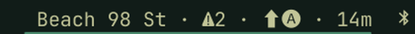
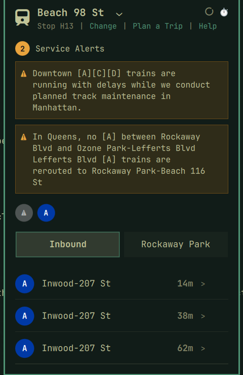
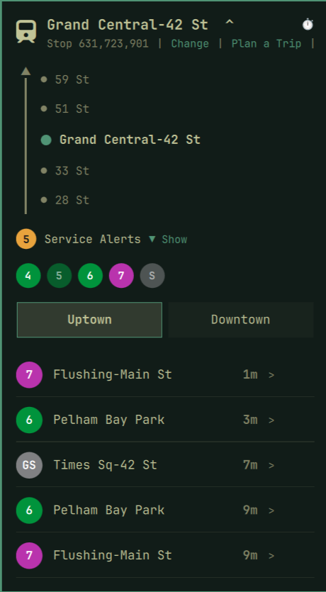
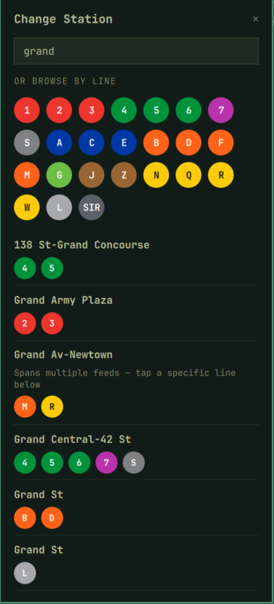
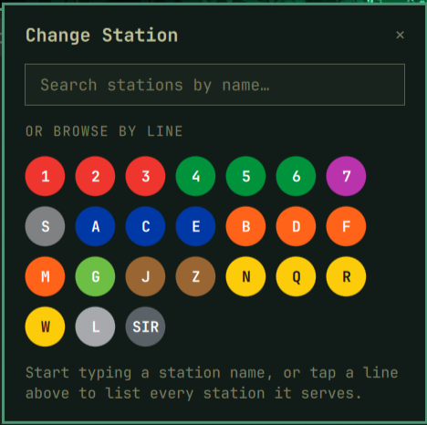
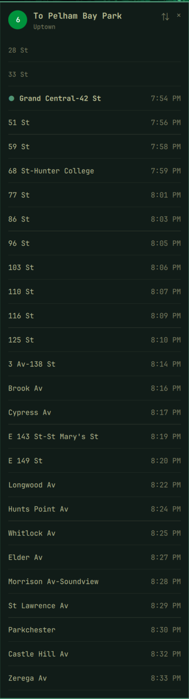
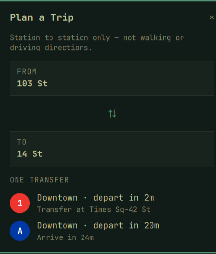

# OMTArchy - NYC Subway MTA

An [Omarchy](https://omarchy.org/) bar widget showing live NYC subway arrivals for a station, straight from the MTA's GTFS-realtime feeds — in the bar at a glance, and in a detail popup for the full picture.

*80% hand-coded, 100% human-reviewed.*





## Features

- **Live arrivals**, both directions, for any subway station or Staten Island Railway stop — no API key needed (MTA's subway realtime feeds have been open since 2019).
- **Real destinations**: each train shows where it actually ends, read from the live trip, so a Lefferts Blvd A is told apart from a Far Rockaway A, and short-turning 4s and 6s say so. Diamond expresses get a ◆, and scheduled trips with no train assigned yet get a `~` (they may not run).
- **Whole-station boards**: tap a station's name in the picker to see every line there on one board — even complexes split across several MTA feeds, like Times Sq (1/2/3, 7, S, A/C/E, N/Q/R/W), which are fetched in parallel. Tap one line's bullet instead to track just that line.
- **Pick your lines**: click a line's circle on the board to hide or show its trains (hover shows − or +); "Select all" brings them all back. The choice is saved per station.
- **Where each train is**: "2 stops away, approaching 51 St", and how late it's running against the MTA timetable ("4 min late").
- **More arrivals on demand**: "+5 more" / "+10 more" under the list.
- **Line Status**: every line at a glance — delays, planned work, good service, or not running right now — with trains in service and the alerts behind each status.
- **Search or browse by line** to find a station, with routes grouped by physical MTA service group (1234567S, ACE, BDFM, G, JZ, NQRW, L, SIR) rather than plain alphabetical order.
- **Service alerts** for the station's lines, split the way the MTA classifies them: live delays and suspensions (counted in the bar), station notices, and a separate collapsed **planned work** section with each change's dates. System-wide notices show on hover.
- **Elevator and escalator outages** at the station, with what each one serves and when it's expected back.
- **Trip planner**: direct and one-transfer routes between any two stations, using the MTA's real transfer walking times — and it suggests a transfer even when there's a direct train, if switching to an express gets you there sooner.
- **Per-train detail**: tap an arrival for that train's remaining stops with clock times, kept up to date while it's open.
- **Leave-now reminders**: set your walk time to the station, and the bar skips trains you can't make and says when to leave; "Remind me" on a train sends a desktop notification when it's time to go.
- **Favorites and commute mode**: save stations with ☆, switch with one tap, and tag one AM and one PM favorite to switch automatically at the time you choose. Get a notification when a new delay hits your commute lines.
- **"I'm on this train"**: tap a train, pick your stop, and the bar counts down to it ("⬆❹ → 59 St · 7m · 4 stops"), with a notification when it's next.
- **"You are here" context strip**: the two nearest physical stations on each side of the tracked station, so an unfamiliar direction label ("Uptown", "Rockaway Park", ...) has concrete meaning.
- The bar shows the next few trains ("⬆❹ · 2m, 6m, ❺ 9m"), and the popup toggles between a relative countdown and clock times.
- Esc steps back one view at a time; if the MTA's data goes stale, the popup and tooltip say how old it is.

## Screenshots

**Whole-station tracking** — pick a multi-line complex and see every platform's arrivals on one board, direction toggle and alert count included.



**Search or browse by line** — stations grouped by physical MTA service group (1234567S, ACE, BDFM, ...), not plain alphabetical order.



**Search results** — every line at a station complex on one row; tap the name for all of them, or a single bullet for just that line.



**Per-train detail** — tap an arrival for that specific train's full remaining stop list, with the two stations immediately before it for context, and a leave-now reminder.



**Trip planner** — direct and one-transfer routes between any two stations, including transfers that beat the direct train.



## Requirements

- Python 3 with the `protobuf` package (`python-protobuf` on Arch) — used to decode MTA's GTFS-realtime feed.

## Installation

```
omarchy plugin add https://github.com/Solicited-Tirade/OMTArchy.git --enable
```

Then set a station via the widget's settings, or open the popup and use "Change" to search by name or browse by line.

To remove it later:

```
omarchy plugin remove tirade.nyc-subway
```

## Configuration

| Setting | Description |
|---|---|
| Line group | Which MTA GTFS-realtime feed to poll for Stop IDs that don't name their own. Set automatically by the station picker. |
| Stop ID | GTFS stop_id for the station, or a comma-separated list for a whole complex; entries may name their own feed as `stopId:feedGroup`. Set automatically by the station picker; a manual fallback for typing one by hand. |
| Direction | `both` shows an Uptown/Downtown toggle; `N` or `S` locks the popup to just that direction. |
| Routes (optional) | Comma-separated route IDs to show (e.g. `1,2,3`). Blank shows every route at the stop. Set by tapping one line's bullet in the picker. |
| Arrivals shown | How many upcoming trains to list per direction in the popup (1-10). |
| Refresh interval | How often to poll, in milliseconds (MTA feeds update roughly every 30s). |
| Trains in the bar | How many upcoming trains the bar lists (1-3). |
| Walk to station | Minutes on foot to the station; drives the bar's "leave in" and the per-train reminder. 0 turns it off. |
| Commute mode | Switch to the AM favorite before the switch hour and the PM favorite after it (right-click a favorite to tag it). |
| Commute switch hour | When commute mode switches from AM to PM (0-23). |
| Alert notifications | Notify on new delays: `off`, `commute` (only on your commute station in commute mode), or `always`. |
| Bar label override | Short name shown in the bar; defaults to the station's name. |

Favorites are managed from the popup (☆ at the top right) and stored in the widget's entry in `shell.json`.

## Data sources

- Live arrivals and service alerts: [MTA GTFS-realtime subway feeds](https://api.mta.info/) (no API key required), including the MTA's own trip and alert extensions (assigned trains, alert types, planned-work dates).
- Elevator and escalator outages: the MTA's equipment outage feeds (`nyct_ene.json`, `nyct_ene_equipments.json`).
- Timetable for lateness: the MTA's static GTFS feed, downloaded at most weekly to `~/.cache/omtarchy` and indexed per tracked station per day in the background.
- Transfer walking times: `transfers.txt` from the MTA's static GTFS feed, baked into `Stations.js` by `bin/generate-station-neighbors.py`.
- Station list, physical line groupings, and neighboring-station data: the [MTA Subway Stations](https://data.ny.gov/Transportation/MTA-Subway-Stations-and-Complexes/5f5g-n3cz) public dataset and MTA's static GTFS feed.

## License

MIT — see [LICENSE](LICENSE).
